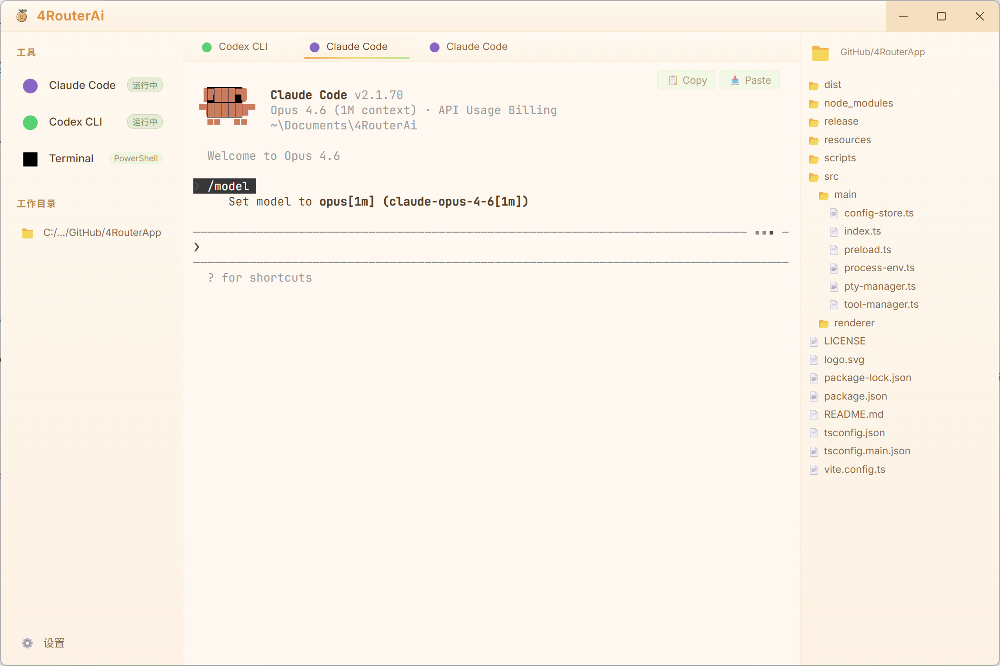

<p align="center">
  
</p>

<h1 align="center">4RouterAi</h1>

<p align="center">
  <strong>一键式多Agent编程助手</strong><br>
  Claude Code & Codex CLI，开箱即用
</p>

<p align="center">
  
  
  
</p>

---

## ✨ 简介

**4RouterAi** 是一个开箱即用的多Agent桌面应用，将 [Claude Code](https://docs.anthropic.com/en/docs/claude-code) (Anthropic) 和 [Codex CLI](https://github.com/openai/codex) (OpenAI) 两大 AI 编程工具整合到一个统一的界面中。无需复杂的环境配置，开箱即用。

<p align="center">
  
</p>

## 🎯 核心特性

### 🔧 双工具集成
- **Claude Code** — Anthropic 的 AI 编程助手，支持自定义 Base URL 和模型选择
- **Codex CLI** — OpenAI 的命令行编程代理，支持 Reasoning Effort 和 Verbosity 调节

### 💻 快捷终端
- 基于 [xterm.js](https://xtermjs.org/) 的全功能终端模拟器
- **多标签页管理** — 同时运行多个 AI 工具和终端会话，自由切换
- 内置 **复制/粘贴** 工具栏，支持 `Ctrl+C` / `Ctrl+V`（Windows）或 `⌘C` / `⌘V`（macOS）快捷键

### 📦 零配置运行环境
- **内置 Node.js 运行时** — 无需全局安装 Node.js
- **内置 MinGit** — Claude Code 运行所需的 Git 环境自动配置（Windows）
- **原生 macOS 支持** — Apple 芯片 / Intel 独立安装包，红绿灯标题栏，自动继承登录 Shell 的 PATH（Homebrew、nvm 等）
- **自动检测更新** — 启动时非阻塞检查 CLI 工具新版本，一键更新

### 📁 文件浏览器
- 侧边面板内置文件树浏览器
- 自动跟随当前活动标签页的工作目录
- 支持展开/折叠目录结构

---

## 📥 安装

### 方式一：下载安装包（推荐）

前往 [Releases](../../releases) 页面下载最新版本：

| 系统 | 安装包 |
| --- | --- |
| Windows (x64) | `4RouterAi Setup <版本>.exe`，双击运行安装 |
| macOS · Apple 芯片 (M 系列) | `4RouterAi-<版本>-mac-arm64.dmg` |
| macOS · Intel | `4RouterAi-<版本>-mac-x64.dmg` |

**macOS 安装**：打开 `.dmg`，把 4RouterAi 拖入「应用程序」文件夹。

安装包未经 Apple 公证，首次打开时系统会提示“无法验证开发者”。任选一种方式放行（只需一次）：

- 在「应用程序」中 **按住 Control 点按** 4RouterAi →「打开」→ 再次点「打开」；
- 或先双击一次，然后前往「系统设置 → 隐私与安全性」，在页面底部点「仍要打开」；
- 或在终端执行：

```bash
xattr -dr com.apple.quarantine /Applications/4RouterAi.app
```

> macOS 说明：
> - 终端与工具会自动继承你登录 Shell（zsh/bash）中的 `PATH`，Homebrew、nvm、pyenv 等安装的命令都可直接使用。
> - Claude Code 依赖 `git`；如果尚未安装，执行 `xcode-select --install` 安装 Xcode 命令行工具。
> - 配置与工具数据位于 `~/Library/Application Support/4RouterAi/`，在应用内更新的 CLI 工具也保存在这里（不会改动 .app 本身）。

---

## 🚀 快速开始

### 1. 首次启动 — 配置 API Key

首次启动应用时，你会看到欢迎页面。在此输入你的 API Key 和Base URL

> 💡 **提示**：你也可以点击「跳过设置」稍后在设置页面中配置。

### 2. 选择工作目录(可选)

在侧栏的「工作目录」区域点击 📁 按钮，选择你的项目文件夹。所有 AI 工具和终端都将在此目录下运行。

### 3. 启动工具

在侧栏点击对应的工具按钮即可启动：

- 🟣 **Claude Code** — 启动 Anthropic 的 AI 编程助手
- 🟢 **Codex CLI** — 启动 OpenAI 的命令行代理
- ⬛ **Terminal** — 启动一个普通终端（Windows 为 PowerShell，macOS 为你的登录 Shell，通常是 zsh）

每点击一次都会创建一个新的标签页，你可以同时运行多个会话。

### 4. 在线更新工具

侧栏中的 badge 会显示工具当前版本号。如果检测到新版本，badge 会变为 **「点击更新」** — 直接点击即可一键更新至最新版，无需重新下载安装包。

---

## ⚙️ 设置

点击侧栏底部的 ⚙️ **设置** 按钮打开设置面板，可配置：

| 设置项               | 说明                                                     |
| -------------------- | -------------------------------------------------------- |
| **API Key**          | Anthropic / OpenAI 的 API 密钥                           |
| **Base URL**         | 自定义 API 端点（支持中转代理）                          |
| **Model**            | 自定义模型名称（如 `opus`、`gpt-5.3-codex`）             |
| **Reasoning Effort** | Codex 的推理力度（如 `xhigh`）                           |
| **Verbosity**        | Codex 的输出详细程度（如 `high`）                        |
| **HTTP(S) 代理**     | 代理地址（如 `http://127.0.0.1:7890`）                   |
| **主题**             | Dark / Light / Fruit                                     |
| **终端字体大小**     | 终端显示字号（默认 14）                                  |
| **终端字体**         | 终端字体族（默认 `JetBrains Mono, Menlo, Consolas, monospace`） |

> 设置底部还有 **调试信息 — 启动参数预览**，可查看工具实际执行的命令和环境变量。 
> 更改设置后需要打开新的终端标签页才能生效。

---

## 🛠️ 开发

```bash
# 安装依赖
npm install
# 启动开发模式（同时启动 main 进程编译和 Vite 开发服务器）
npm run dev
# 在另一个终端中启动 Electron
npm start
```

### 打包

```bash
# Windows：NSIS 安装包（在 Windows 上执行）
npm run package

# macOS：DMG（在 macOS 上执行），默认只构建本机架构
npm run package:mac
# 同时构建 Apple 芯片与 Intel 两个 DMG
bash scripts/build-mac.sh all
```

产物位于 `release/`。macOS 下内置的 Node.js 运行时会从 nodejs.org（失败时回退 npmmirror）下载官方构建并校验 SHA-256，版本默认与执行打包的 Node 一致，可用 `BUNDLE_NODE_VERSION=v24.x.x` 指定；`TARGET_ARCH=x64` 可在 Apple 芯片机器上打 Intel 包。

没有签名证书时，macOS 应用会被 ad-hoc 签名（`scripts/mac-adhoc-sign.cjs`）。如需可直接分发、无系统拦截的版本，配置 Developer ID 证书（`CSC_LINK` / `CSC_KEY_PASSWORD`）并按 electron-builder 文档提供公证凭据（`APPLE_ID` / `APPLE_APP_SPECIFIC_PASSWORD` / `APPLE_TEAM_ID`）即可，hardened runtime 所需的 entitlements 已在 `build/entitlements.mac.plist` 中配置。

### 项目结构

```
4RouterApp/
├── src/
│   ├── main/                   # Electron 主进程
│   │   ├── index.ts            # 主入口，窗口创建和 IPC 注册
│   │   ├── tool-manager.ts     # 工具发现、启动配置和更新管理
│   │   ├── pty-manager.ts      # PTY 终端会话管理（node-pty）
│   │   ├── config-store.ts     # 配置存储与 API Key 加密
│   │   ├── preload.ts          # IPC 桥接，暴露安全 API 给渲染进程
│   │   ├── process-env.ts      # 环境变量白名单过滤
│   │   └── shell-env.ts        # macOS：读取登录 Shell 的环境（PATH/LANG）
│   └── renderer/               # 渲染进程（前端 UI）
│       ├── index.html          # 主页面
│       ├── app.js              # 应用逻辑
│       └── styles/global.css   # 全局样式
├── scripts/
│   ├── bundle-tools.mjs        # 打包工具脚本（下载 CLI 和运行时）
│   ├── build*.bat / build.ps1  # Windows 构建脚本
│   ├── build-mac.sh            # macOS 构建脚本（DMG）
│   └── mac-adhoc-sign.cjs      # macOS 无证书时的 ad-hoc 签名
├── build/
│   └── entitlements.mac.plist  # macOS hardened runtime entitlements
├── resources/
│   ├── bundled-tools/          # 内置的 CLI 工具和运行时
│   ├── icon.ico                # 应用图标（Windows）
│   └── icon.icns               # 应用图标（macOS）
├── vite.config.ts              # Vite 构建配置
└── package.json                # 项目配置
```
---

## 📝 许可证

[MIT License](LICENSE)

---

<p align="center">
  <sub>Made with ⚡ by 4RouterAi</sub>
</p>
